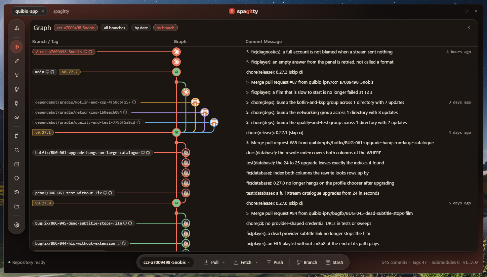

<!--
  Workbench — CIB's internal developer workbench, based on Spagitty.
  Copyright (c) 2026 Mahmoud Aref. Released under the MIT licence; see LICENSE.
-->

# Workbench

**CIB Workbench · Git, reviews and agents in one place**

[Screens](docs/screens.md) · [Architecture](docs/architecture.md) · [Extensions](docs/extensions/) · [Staying in sync with Spagitty](docs/workbench-sync.md) · [Licence](LICENSE)

> **INTERNAL USE ONLY** · In development and provided as is. Use at your own risk.
>
> CIB and the CIB logo are trademarks of Commercial International Bank (Egypt) S.A.E. Workbench is based on Spagitty and released under the MIT licence.

Workbench is Spagitty with CIB's identity: the same screens and behaviour, the Workbench name and the CIB palette. The rest of this page describes Spagitty, which Workbench is based on.

Spagitty is a desktop Git client built with Tauri, Rust and Svelte. It covers
the everyday work of a Git client: history, diffs, staging, rebasing, conflicts
and pull requests. It can also run the coding agents already installed on your
machine against a goal: one task per agent, each on its own branch and worktree.

Spagitty ships no model and no API key, and it has no account or server of its
own.

## License

Spagitty is licensed under the [GNU General Public License v3.0 or later](LICENSE).
See [`NOTICE`](NOTICE) for third-party attributions.

The Sora typeface is licensed under the SIL Open Font License 1.1. Spagitty is
not affiliated with the Git project. Git and the Git logo are trademarks of
Software Freedom Conservancy.
